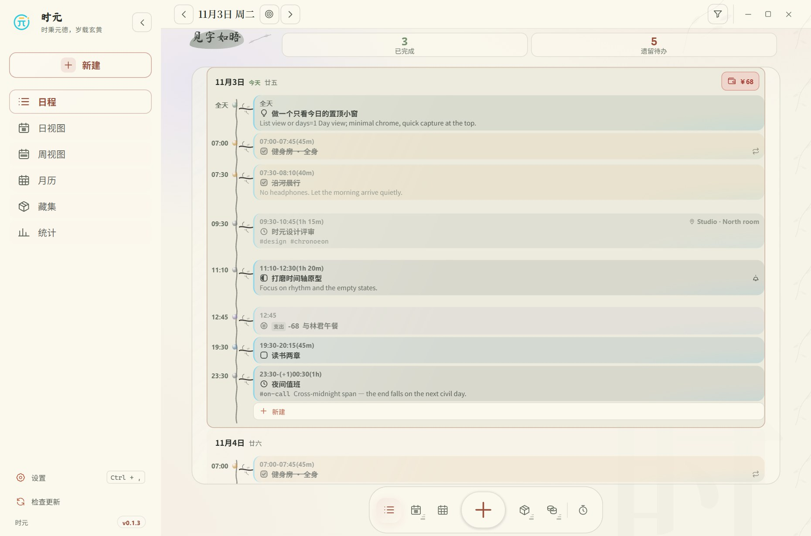
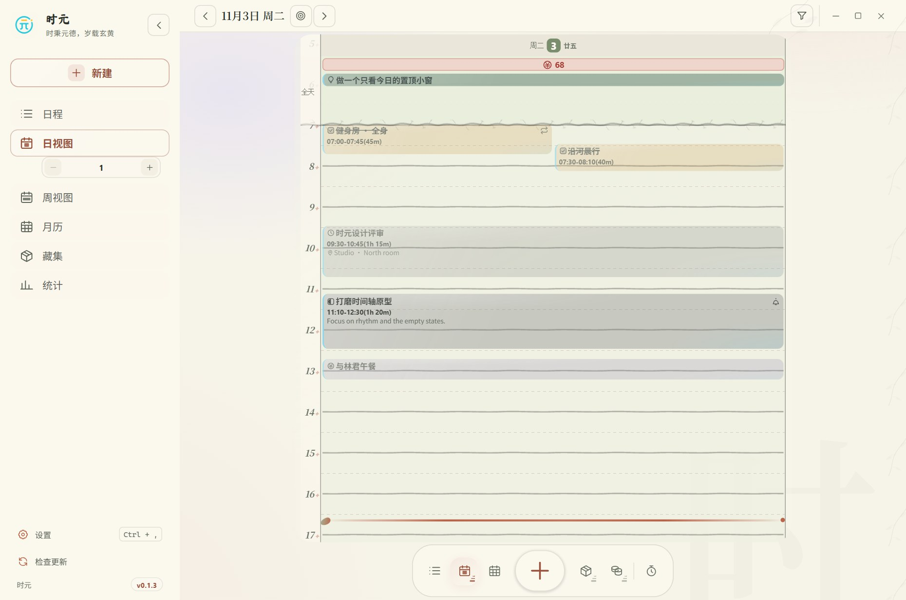
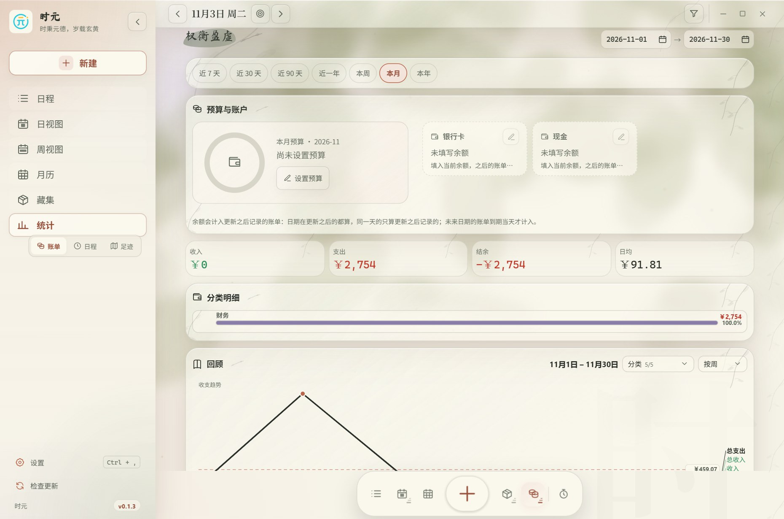
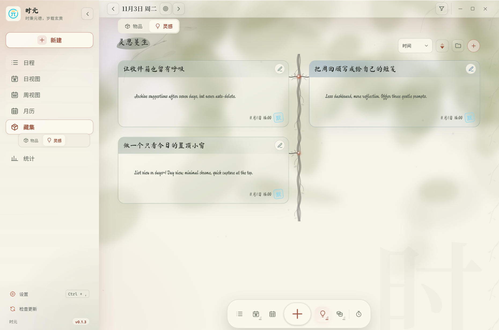
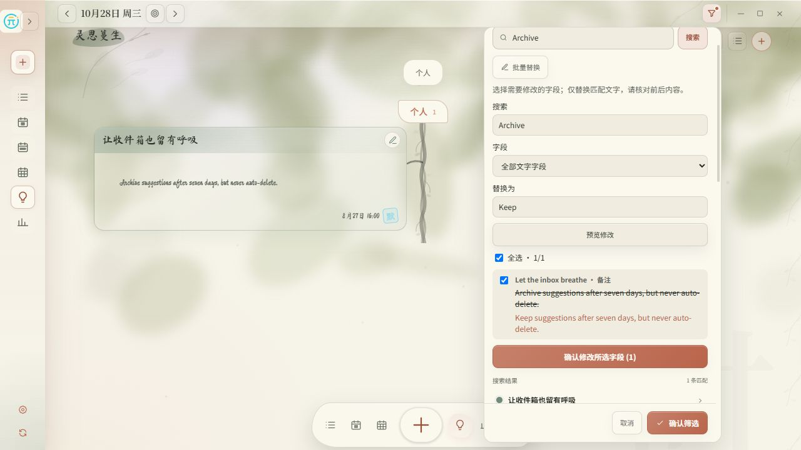
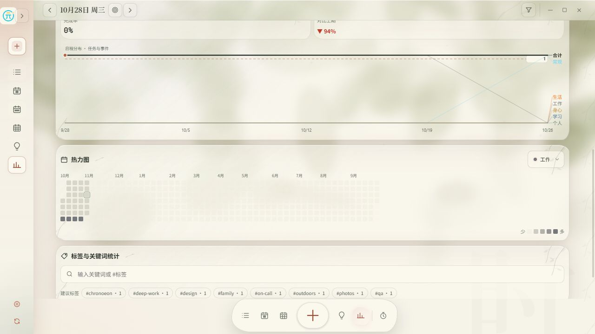

# ChronoEon · 时元

> **Grace in time, worlds in years.**<br>
> 时秉元德，岁载玄黄。

A local-first home for **schedules, tasks, ideas and expenses**, for Windows,
Linux, macOS and Android. SQLite is the authoritative store.
时元是一款本地优先的日程、任务、日记、灵感、收支与物品管理应用。

**v0.1.2** · [Download / 下载](https://github.com/lub23/ChronoEon/releases/tag/v0.1.2)

日常使用请打开构建或安装后的 ChronoEon；`tauri:dev` 用于开发。Windows 原生 dev 与 exe 共用 `%LOCALAPPDATA%\app.chronoeon.desktop\chronoeon.db`，本机设置也保存于该 SQLite 数据库；浏览器演示的数据独立。
Use the built application for daily work. Native dev and packaged builds share SQLite records and device settings; the browser demo is separate.










The product code is `apps/chronoeon/` (`app.chronoeon.desktop`). `packages/*`
holds the UI-independent rules: `domain`, `storage`, `ports`.

## What is new in 0.1.2 / 本版更新

- Ask streams its answer and tool steps in one process card. Relative periods such as “last month” resolve on the device; elapsed time stops when the answer completes and excludes saving and connection shutdown. / 随心问流式展示检索与回答过程，在本机确定“上个月”等日期；回复完成即停止计时，不计入保存及等待连接关闭的时间。
- Capture understands current-time ranges and meal times, learns common record habits and shows notes in draft summaries. Review all AI drafts before saving. / 随心记完善“现在到…”、跨日范围和用餐时间，参考历史记录习惯，草稿摘要显示备注；AI 草稿须确认后保存。
- Paste up to four images into a conversation. Stored images use compressed WebP; native compression and WebDAV transfers are faster. / 对话支持粘贴最多四张图片，复用压缩后的 WebP，优化原生压缩与 WebDAV 传输。
- Mobile conversation drawers support swipes; idea/item groups, filters, category details and transitions are clearer. Four additional accent colors follow light/dark themes. / 手机对话侧栏支持滑动，优化灵感/物品分组、筛选、分类明细和过渡，新增胭脂、琥珀、靛青、黛墨主题色。
- Local Windows and APK builds work from ordinary PowerShell with installed toolchains discovered automatically. / 保留本地手动构建与调试命令，普通 PowerShell 自动加载已安装的 Windows / Android 工具链。

## Run the browser demo

Use Node.js 24+ (the storage tests use the built-in `node:sqlite` module). / 使用 Node.js 24+（存储测试依赖内置 `node:sqlite`）。

```bash
npm install
npm run dev          # http://localhost:1420
```

The demo keeps everything in browser local storage. What it shows: the List /
Day / Week / Month / Ideas / Statistics views, the Dock with
its quick-note button, natural-language capture, both
languages and both themes.

## Build and test

```bash
npm run build          # production frontend
npm run check          # production build + every package's tests and type checks
npm test               # tests only (domain, storage, app)
npm run test:app       # the primary app suite
npm run verify:windows # Windows metadata / native cross-check
```

## Desktop shell

The Tauri 2 shell lives in `apps/chronoeon/src-tauri`:
See the [official prerequisites / 官方环境要求](https://v2.tauri.app/start/prerequisites/)
for platform toolchain installation.

```bash
npm run tauri:dev      # dev server + native window on the fixed port 1420
npm run tauri:build    # packaged desktop installers
npm run windows:build # Windows: automatically load MSVC, then build EXE + NSIS + MSI
npm run windows:build -- --debug # native debug build + installers
```

Dev mode always uses port `1420` because `devUrl` and Vite must agree. If a
previous interrupted run still holds the port, stop only that process:

```bash
lsof -nP -iTCP:1420 -sTCP:LISTEN   # macOS/Linux
kill <pid>
npm run tauri:dev
```

Ubuntu needs the WebKitGTK development packages from the official Tauri guide
(`libwebkit2gtk-4.1-dev librsvg2-dev libxdo-dev libssl-dev
libayatana-appindicator3-dev` plus build tools). Windows needs Node 24+, the
stable Rust toolchain and WebView2. The repository `.npmrc` overrides a
machine-level `npm global` setting that otherwise breaks the workspace scripts;
if this checkout was copied from another OS, run `npm run doctor:windows`
before building. Install Visual Studio C++ Build Tools (MSVC x64/x86 and Windows SDK).
`npm run windows:build` discovers the installation with `vswhere` and loads its
x64 environment, so it works from ordinary PowerShell without a Native Tools prompt.

Windows 手动构建：安装 Node.js 24+、stable Rust、WebView2、Visual Studio C++ Build Tools
（MSVC x64/x86 和 Windows SDK），在仓库根目录运行：

```powershell
npm install
npm run windows:build
# Portable EXE / 直接运行：apps/chronoeon/src-tauri/target/release/chronoeon-app.exe
# NSIS installer / 安装包：apps/chronoeon/src-tauri/target/release/bundle/nsis/*.exe
# MSI installer / 安装包：apps/chronoeon/src-tauri/target/release/bundle/msi/*.msi
npm run tauri:dev # native development with hot reload / 原生窗口热更新调试
```

Close the executable running from `target/release` (or `target/debug`) before
rebuilding; Windows locks running EXE files and Cargo otherwise reports
“Access is denied”. / 重建前先关闭从构建目录运行的旧程序，否则 Windows 文件占用会导致“拒绝访问”。

For native debugging, use `npm run windows:build -- --debug`; outputs are under
`target/debug` instead of `target/release`. / 原生调试构建加 `--debug`，输出在 `target/debug`。

## Android APK

```bash
npm install
npm run android:apk     # → .build/android/ChronoEon-<version>-arm64.apk
```

That command builds the frontend, the `aarch64-linux-android` Rust library,
the Gradle release variant, then aligns and signs the APK. What it needs:

| Requirement            | Notes                                                                                                                                                                                       |
| ---------------------- | ------------------------------------------------------------------------------------------------------------------------------------------------------------------------------------------- |
| JDK 17                 | `JAVA_HOME`                                                                                                                                                                                 |
| Windows host toolchain | MSVC C++ Build Tools + Windows SDK; automatically loaded with `vswhere` / 自动加载，无需专用终端 |
| Android SDK + NDK      | `ANDROID_HOME` / `ANDROID_SDK_ROOT`; the newest NDK under it is picked automatically, or set `NDK_HOME`                                                                                     |
| Rust + target          | `rustup target add aarch64-linux-android`                                                                                                                                                   |
| Perl + make | OpenSSL compilation needs Perl and make. On Windows the script discovers Git for Windows' Perl and uses the NDK's make; otherwise install Perl and make on PATH. / Windows 自动使用 Git Perl 与 NDK make；也可用 `CHRONOEON_PERL` 指定 Perl bin 目录。 |

Windows 默认 SDK 路径为 `D:\Android\Sdk`；其他位置请设置 `ANDROID_HOME`，JDK 17 设置
`JAVA_HOME`。脚本会完整编译当前前端和 Rust、签名并验证 APK；同版本重建覆盖同一路径。
Windows defaults to `D:\Android\Sdk`; set `ANDROID_HOME` for another location and
`JAVA_HOME` for JDK 17. Each build compiles the current frontend and Rust, signs
and verifies the APK, and overwrites the same version's output.

```powershell
rustup target add aarch64-linux-android
npm run android:apk
adb install -r .build/android/ChronoEon-0.1.2-arm64.apk
adb logcat # inspect device logs / 查看真机日志
```

Signing uses `CHRONOEON_KEYSTORE` (+ `CHRONOEON_KEYSTORE_PASSWORD`,
`CHRONOEON_KEY_ALIAS`). Without them the script creates and uses a debug key, so
the result still installs on a phone; keep a release keystore outside the repository or in CI secrets for anything you
distribute, and never commit it.

Use `npm run android:apk` for the manual APK build. It copies the native library
and invokes Gradle directly, avoiding Windows symlink permissions and Gradle's
nested npm argument forwarding. / 本地 APK 使用此命令，无需开启 Windows 开发者模式。

Build outputs stay ignored by Git. Keep the current APK and Windows `bundle`
outputs for installation; old downloaded installers and duplicate APKs can be
deleted. Preserve signing keys and `.build/data-safety` backups.
构建产物不提交 Git；旧下载包、重复 APK 可删除，签名密钥及 `.build/data-safety` 备份须保留。

## Every platform from GitHub

Push a `v*` tag, or run **Release** manually with an existing tag. The workflow
in [`.github/workflows/release.yml`](.github/workflows/release.yml) builds and
uploads:

| Job     | Output                                 |
| ------- | -------------------------------------- |
| Windows | portable EXE + NSIS installer + MSI                   |
| Linux   | AppImage + deb                         |
| macOS   | universal (arm64 + x86_64) dmg         |
| Android | signed arm64 APK (`chronoeon-android`) |

Installers are attached to a draft GitHub Release and retained as workflow artifacts. Publish the draft after all four jobs pass. / 四个平台构建通过后发布 Release 草稿。 `ANDROID_KEYSTORE_BASE64` (+ password/alias) secrets
switch the APK from the debug key to yours.

## Data and sync

- SQLite is authoritative. Migrations are append-only and versioned by
  `PRAGMA user_version`; the in-memory index is disposable.
- Settings and catalogs — languages, themes, calendars, categories, sync
  targets — live in the settings document, which the desktop app stores in its
  `sync_settings` row and applies on boot. The browser demo keeps the same
  document in local storage.
- Cross-device sync uses WebDAV over HTTPS; Git synchronization is no longer supported.
  / 跨设备同步使用 HTTPS WebDAV，已移除 Git 同步。 See [sync recovery / 同步排障](SYNC_RECOVERY.md).
- WebDAV uploads after 15 seconds without edits and checks peers every five minutes.
  / WebDAV 停止编辑 15 秒后上传，每 5 分钟检查其他设备。
- Android timing runs in a separate native process; reminders use system alarms.
  / Android 使用独立原生进程计时和系统闹钟提醒，无需保持页面运行。
- Sync is a semantic journal: per-entity operations, deterministic conflicts
  with both versions preserved, seven-day snapshots and a Recycle Bin that
  survives until the next successful snapshot.
- AI capture and the advisor are provider-independent and opt-in. Endpoint URLs
  and keys stay local; the built-in dictionary-free capture parser works
  offline.

## Repository map

```text
apps/chronoeon/        PRIMARY APP — React/Vite UI + Tauri 2 shell (+ Android)
  src/                 product UI and local-first bridges
  src-tauri/           Rust commands, capabilities, Android project
  scripts/             Android / Windows build scripts, icon sync, verification helpers
packages/              domain rules, SQLite storage, ports
.github/workflows/     release.yml (all platforms), windows.yml
```

## License

MIT. See [LICENSE](LICENSE).

## Support / 支持

If ChronoEon is useful to you, you can buy me a coffee with WeChat.
如果时元对你有帮助，欢迎通过微信请作者喝杯咖啡。


## Everyday workflows / 日常操作

- Search → Batch replace → select a field and replacement → preview and tick changes → apply. Entry and item edits commit together; Data → Operation history can restore the whole batch. Literal replacement is case-sensitive. / 搜索后点击“批量替换”，选择字段与替换文字，预览并勾选后确认；条目与物品统一提交，可在“设置 → 数据 → 操作历史”恢复整批修改。按字面匹配，区分英文大小写。
- Filters keep a draft until **Apply filters** (or an explicit Search submission). Cancel, Escape or tapping outside discards uncommitted selections. / 筛选选项先保留草稿，点击“确认筛选”或主动提交搜索后生效；取消、Esc 或点击外部放弃未提交选择。
- API keys support native clipboard paste. Ask displays search/tool results, generation steps, elapsed time and streamed text; capture streams progress while validating the structured draft before review. Partial answers are never saved. / 密钥支持粘贴；随心问显示检索结果、生成步骤、耗时与流式正文，随心记显示流式识别进度并在字段核验后交付草稿，未完成回答不会保存。

Agent progress follows the transparency pattern described in [Building effective agents](https://www.anthropic.com/research/building-effective-agents), using [Tauri Channels](https://v2.tauri.app/develop/calling-frontend/#channels) for native streaming.
