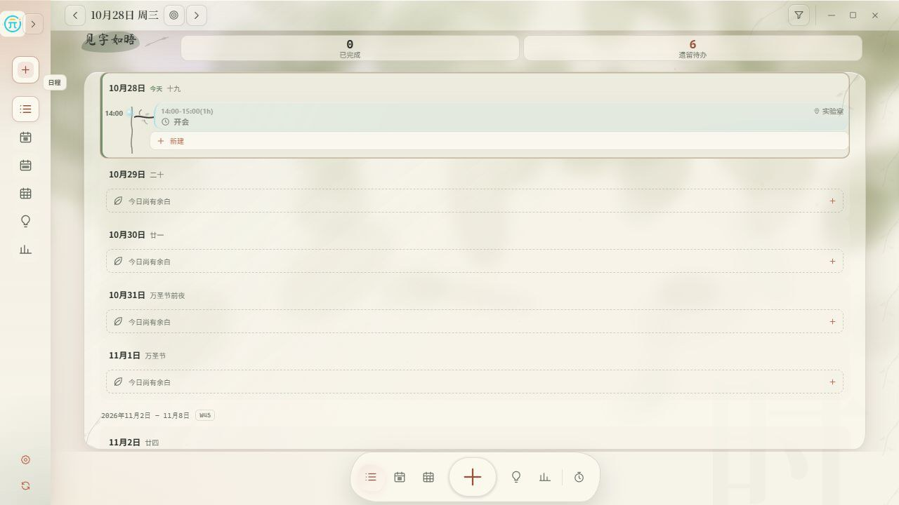
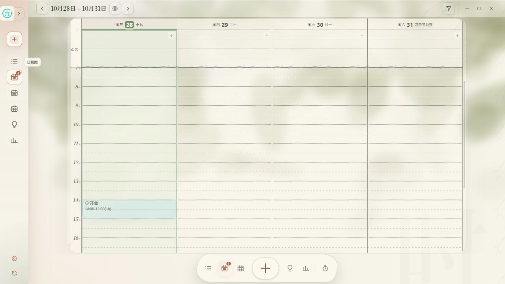
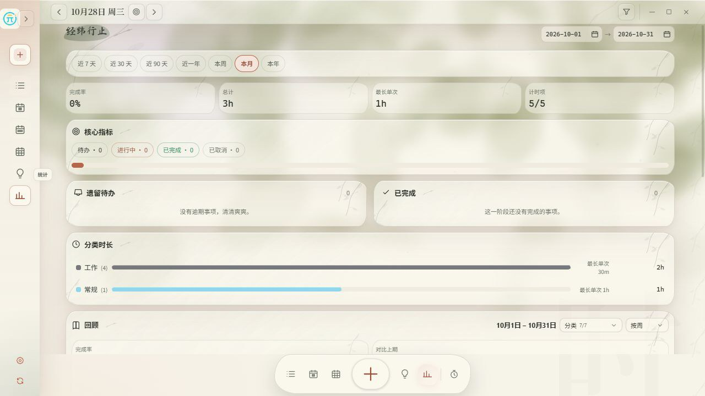
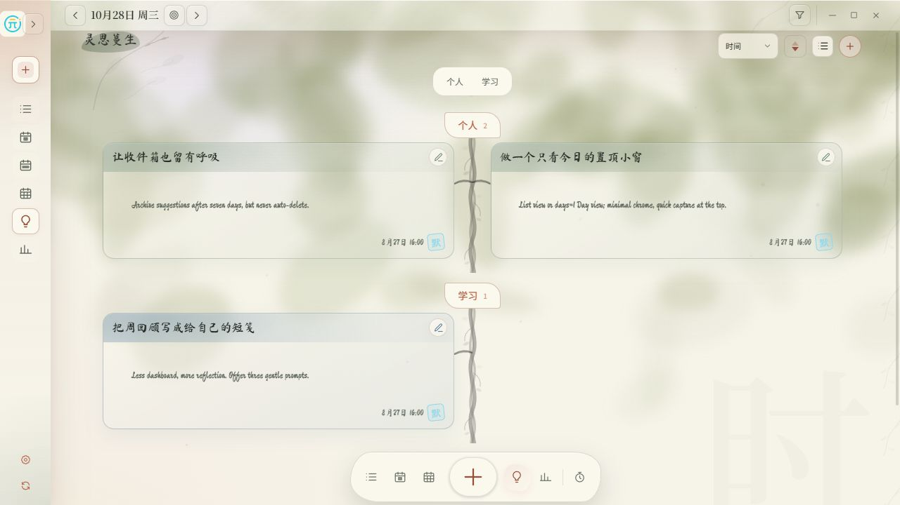
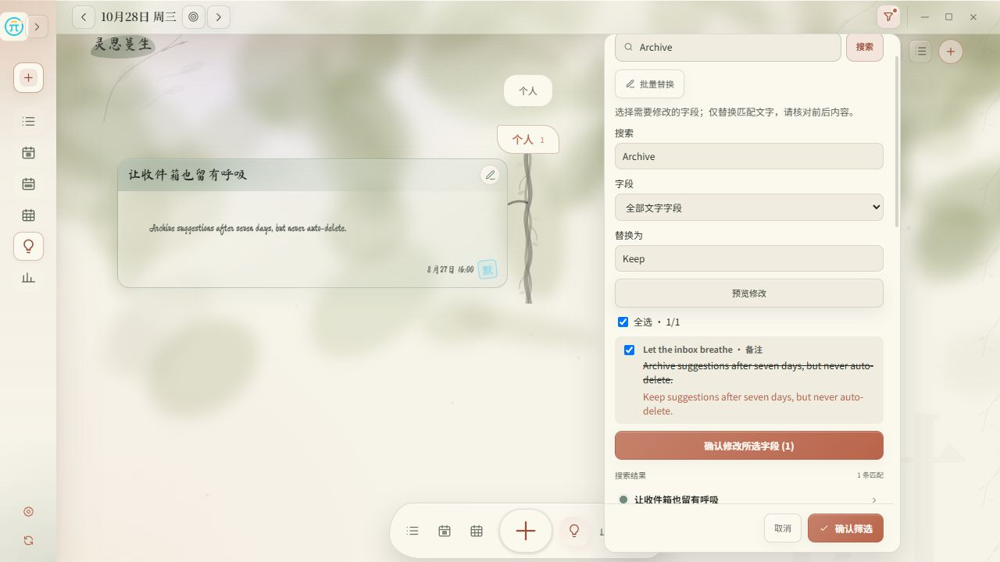
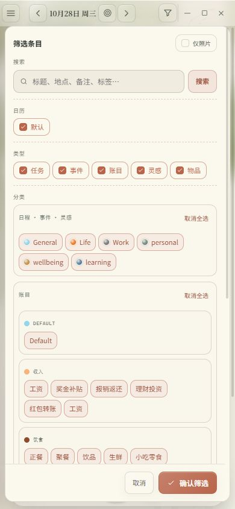
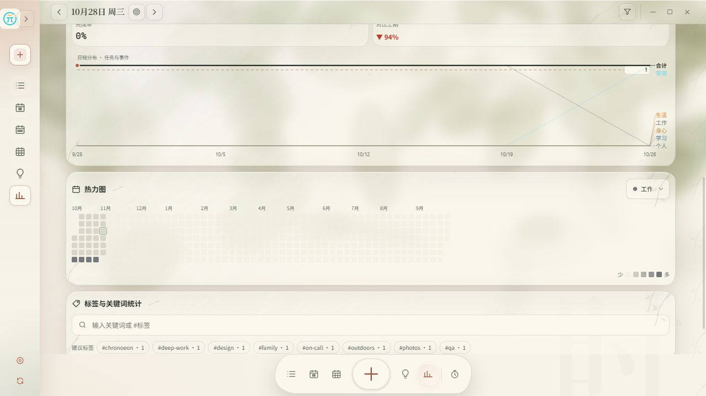

# ChronoEon · 时元

> **Grace in time, worlds in years.**<br>
> 时秉元德，岁载玄黄。

A local-first home for **schedules, tasks, ideas and expenses**, for Windows,
Linux, macOS and Android. SQLite is the authoritative store.

**v0.1.0 — first stable release / 首个正式版本。** [Download / 下载](https://github.com/lub23/ChronoEon/releases/tag/v0.1.0)

日常使用请打开构建或安装后的 ChronoEon；`tauri:dev` 用于开发。Windows 原生 dev 与 exe 共用 `%LOCALAPPDATA%\app.chronoeon.desktop\chronoeon.db`，本机设置也保存于该 SQLite 数据库；浏览器演示的数据独立。
Use the built application for daily work. Native dev and packaged builds share SQLite records and device settings; the browser demo is separate.










The product code is `apps/chronoeon/` (`app.chronoeon.desktop`). `packages/*`
holds the UI-independent rules: `domain`, `storage`, `ports`.

## Run the browser demo

Use Node.js 24+ (the storage tests use the built-in `node:sqlite` module). / 使用 Node.js 24+（存储测试依赖内置 `node:sqlite`）。

```bash
npm install
npm run dev          # http://localhost:1420
```

The demo keeps everything in browser local storage. What it shows: the List /
Day / Week / Month / Ideas / Statistics views, the Dock with
its quick-note button, natural-language capture, both
languages and both themes.

## Build and test

```bash
npm run build          # production frontend
npm run check          # production build + every package's tests and type checks
npm test               # tests only (domain, storage, app)
npm run test:app       # the primary app suite
npm run verify:windows # Windows metadata / native cross-check
```

## Desktop shell

The Tauri 2 shell lives in `apps/chronoeon/src-tauri`:

```bash
npm run tauri:dev      # dev server + native window on the fixed port 1420
npm run tauri:build    # packaged desktop installers
```

Dev mode always uses port `1420` because `devUrl` and Vite must agree. If a
previous interrupted run still holds the port, stop only that process:

```bash
lsof -nP -iTCP:1420 -sTCP:LISTEN   # macOS/Linux
kill <pid>
npm run tauri:dev
```

Ubuntu needs the WebKitGTK development packages from the official Tauri guide
(`libwebkit2gtk-4.1-dev librsvg2-dev libxdo-dev libssl-dev
libayatana-appindicator3-dev` plus build tools). Windows needs Node 24+, the
stable Rust toolchain and WebView2. The repository `.npmrc` overrides a
machine-level `npm global` setting that otherwise breaks the workspace scripts;
if this checkout was copied from another OS, run `npm run doctor:windows`
before `npm run tauri:build`.

## Android APK

```bash
npm install
npm run android:apk     # → .build/android/chronoeon-arm64-YYYYMMDD.apk
# v0.1.0 local verified output: .build/android/ChronoEon-0.1.0-arm64.apk
```

That command builds the frontend, the `aarch64-linux-android` Rust library,
the Gradle release variant, then aligns and signs the APK. What it needs:

| Requirement            | Notes                                                                                                                                                                                       |
| ---------------------- | ------------------------------------------------------------------------------------------------------------------------------------------------------------------------------------------- |
| JDK 17                 | `JAVA_HOME`                                                                                                                                                                                 |
| Windows host toolchain | MSVC C++ Build Tools + Windows SDK; use the x64 Native Tools prompt so `link.exe` is the MSVC linker, not Git/coreutils                                                                     |
| Android SDK + NDK      | `ANDROID_HOME` / `ANDROID_SDK_ROOT`; the newest NDK under it is picked automatically, or set `NDK_HOME`                                                                                     |
| Rust + target          | `rustup target add aarch64-linux-android`                                                                                                                                                   |
| `perl`                 | only for a **Rust** rebuild: the HTTPS transport vendors OpenSSL, whose Configure step is a Perl script. Install Strawberry Perl, or set `CHRONOEON_SKIP_CARGO=1` to repackage the library already built |

Signing uses `CHRONOEON_KEYSTORE` (+ `CHRONOEON_KEYSTORE_PASSWORD`,
`CHRONOEON_KEY_ALIAS`). Without them the script creates and uses a debug key, so
the result still installs on a phone; keep a release keystore outside the repository or in CI secrets for anything you
distribute, and never commit it.

`npm run tauri android build --apk --target aarch64` then builds the
same APK. It needs **Windows Developer Mode** (Tauri symlinks the Rust library
into the Gradle jniLibs folder) and npm ≤ 10, because Gradle's rust task
re-enters `npm run … --release --target`, which npm 11+ rejects as unknown
config flags. `npm run android:apk` avoids both traps.

## Every platform from GitHub

Push a `v*` tag, or run **Release** manually with an existing tag. The workflow
in [`.github/workflows/release.yml`](.github/workflows/release.yml) builds and
uploads:

| Job     | Output                                 |
| ------- | -------------------------------------- |
| Windows | NSIS installer + MSI                   |
| Linux   | AppImage + deb                         |
| macOS   | universal (arm64 + x86_64) dmg         |
| Android | signed arm64 APK (`chronoeon-android`) |

Installers are attached to the published release and retained as workflow artifacts. `ANDROID_KEYSTORE_BASE64` (+ password/alias) secrets
switch the APK from the debug key to yours.

## Data and sync

- SQLite is authoritative. Migrations are append-only and versioned by
  `PRAGMA user_version`; the in-memory index is disposable.
- Settings and catalogs — languages, themes, calendars, categories, sync
  targets — live in the settings document, which the desktop app stores in its
  `sync_settings` row and applies on boot. The browser demo keeps the same
  document in local storage.
- WebDAV uploads after 15 seconds without edits and checks peers every five minutes.
  / WebDAV 停止编辑 15 秒后上传，每 5 分钟检查其他设备。
- Android timing runs in a separate native process; reminders use system alarms.
  / Android 使用独立原生进程计时和系统闹钟提醒，无需保持页面运行。
- Sync is a semantic journal: per-entity operations, deterministic conflicts
  with both versions preserved, seven-day snapshots and a Recycle Bin that
  survives until the next successful snapshot.
- AI capture and the advisor are provider-independent and opt-in. Endpoint URLs
  and keys stay local; the built-in dictionary-free capture parser works
  offline.

## Repository map

```text
apps/chronoeon/        PRIMARY APP — React/Vite UI + Tauri 2 shell (+ Android)
  src/                 product UI and local-first bridges
  src-tauri/           Rust commands, capabilities, Android project
  scripts/             build-android.mjs, icon sync, verification helpers
packages/              domain rules, SQLite storage, ports
.github/workflows/     release.yml (all platforms), windows.yml
```

## License

MIT. See [LICENSE](LICENSE).

## Support / 支持

If ChronoEon is useful to you, you can buy me a coffee with WeChat.
如果时元对你有帮助，欢迎通过微信请作者喝杯咖啡。


## v0.1.0 everyday workflows / 日常操作

- Search → Batch replace → select a field and replacement → preview and tick changes → apply. Entry and item edits commit together; Data → Operation history can restore the whole batch. Literal replacement is case-sensitive. / 搜索后点击“批量替换”，选择字段与替换文字，预览并勾选后确认；条目与物品统一提交，可在“设置 → 数据 → 操作历史”恢复整批修改。按字面匹配，区分英文大小写。
- Filters keep a draft until **Apply filters** (or an explicit Search submission). Cancel, Escape or tapping outside discards uncommitted selections. / 筛选选项先保留草稿，点击“确认筛选”或主动提交搜索后生效；取消、Esc 或点击外部放弃未提交选择。
- API keys support native clipboard paste. Ask displays search/tool results, generation steps, elapsed time and streamed text; capture streams progress while validating the structured draft before review. Partial answers are never saved. / 密钥支持粘贴；随心问显示检索结果、生成步骤、耗时与流式正文，随心记显示流式识别进度并在字段核验后交付草稿，未完成回答不会保存。

Agent progress follows the transparency pattern described in [Building effective agents](https://www.anthropic.com/research/building-effective-agents), using [Tauri Channels](https://v2.tauri.app/develop/calling-frontend/#channels) for native streaming.
